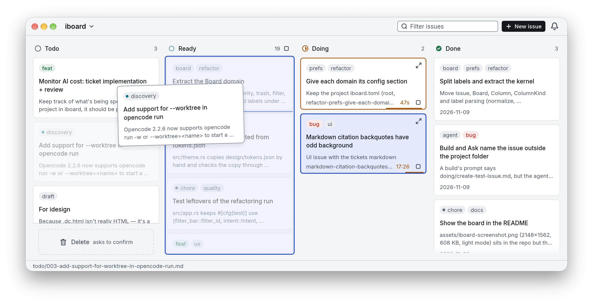

<h1 align="center">
  <picture>
    <source media="(prefers-color-scheme: dark)" srcset="assets/iboard-wordmark-dark.svg">
    
  </picture>
</h1>

> [!NOTE]
> **iboard** is an opinionated issue tracker that lives entirely as Markdown files right next to your code.

<p align="center">
  
</p>

⚡ Why iboard?

Designed for small, high-impact teams and solopreneurs, it eliminates the friction of bouncing between Jira, Notion, and GitHub. 
It is dead simple, `iboard` is a small binary with no external services, and no browser. Navigate, create, and resolve tasks entirely from your keyboard.

* Designed for tight feedback loops. Spend your time building the product, not tinkering with the project management software. 
* Completely open-source: bring your ideas, contribute and fork it! Fit your workflow to your needs.

## 🧠 How It Works

Issues are just `.md` files. Columns are just folders. Issues flow from left to right through your file system:

```text
📁 issues/
 ├── 📁 todo/   # Unrefined ideas and raw backlog
 ├── 📁 ready/  # Refined, actionable tasks (prefix with `001-` to prioritize)
 ├── 📁 doing/  # The active work in progress
 └── 📁 done/   # Finished, verified, and ready to push
```

Because everything is file-based, iboard integrates flawlessly with your IDE, your terminal, and any AI agents arround.

## Use-it!

```sh
iboard                     # open the app on the latest project
iboard .                   # open the app on the current working directory
iboard ~/code/my-project   # open the app on the given directory
iboard init ~/new-app      # create issues/ (todo, ready, doing, done) and configuration
iboard --list              # print the current directory's board to stdout, no window
iboard --all --list        # print every workspace project's board, merged
```

One iboard runs at a time: when it is already open, `iboard` brings its window
forward, and `iboard ~/code/my-project` shows that project in it.

## Install

Download the `iboard-<version>-aarch64-apple-darwin.zip` asset from the
[latest release](https://github.com/cdesiles/iboard/releases/latest), unzip it, and move
`iboard.app` to `~/Applications`. A first install needs no toolchain, just macOS 12 or later
on Apple silicon:

```sh
asset=$(curl -fsSL https://api.github.com/repos/cdesiles/iboard/releases/latest |
  sed -n 's/.*"browser_download_url": "\(.*aarch64-apple-darwin\.zip\)".*/\1/p')
curl -L "$asset" -o /tmp/iboard.zip
ditto -x -k /tmp/iboard.zip ~/Applications
open ~/Applications/iboard.app
```

The app checks GitHub for a newer release when it opens and every six hours. When one exists,
the status bar offers `Update to x.y.z`: it downloads the bundle, replaces the running copy and
reopens it on the same project.

## Building from sources

From this repository:

```sh
make build        # the binaries, in target/debug
make install      # the CLI commands (iboard, idesign) and iboard.app
make install-app  # just iboard.app, into ~/Applications
```

Get help with `make help`.

## Issues format 

The format is intentionally free.

1. Starting from the given path (else the latest project, or the current
   directory for `init` and `--list`), it looks for a `issues/` directory,
   walking up through parent folders. A config file below can override the
   location.
2. Inside the issues root, it builds columns from:
   - **Known sub-directories**, always shown even when empty, in kanban order:
     `backlog`, `todo`, `ready`, `doing`/`in-progress`/`wip`, `review`, `later`,
     `blocked`, `done`.
   - **Other sub-directories**, shown only if they directly contain markdown
     files.
   - **Markdown files at the issues root**, which form the first column
     (`Todo`, or `Backlog` when a `todo/` directory also exists).
3. Files are ordered naturally, so `2-foo.md` comes before `10-bar.md`.
   Doing and Done are the exception: most recently edited first.

### Issue title and summary

Nothing about the markdown is required:

- **Title**: first `# Heading`, else the first non-empty line, else a prettified
  file name (`2026-05-29-merge-nut-exporter` → `Merge nut exporter`).
- **Summary**: the first prose paragraph (or first list item if there is no
  prose), stripped of markdown syntax and truncated to 180 characters with
  `...`.

## Optional configuration

Drop an `iboard.toml` at the project root to override
discovery:

```toml
root = "issues"                         # where the issues live
columns = ["backlog", "doing", "done"]  # explicit order; omit to auto-detect
root_column_name = "Backlog"            # name for the root-level files column
title = "My foo project"                # window title
```

### Releasing

Done's Release flag writes the note, commits it, tags and pushes. A project that keeps its
version in a file (`Cargo.toml`, `package.json`, `pyproject.toml`…) says how to bump it in a
`.iboard.toml` at its root:

```toml
[release]
prepare = 'make version V="$IBOARD_VERSION"'   # runs before the release commit
files = ["Cargo.toml", "Cargo.lock"]          # what it changes: committed with the note
```

`prepare` runs from the project root in your login shell, with `IBOARD_TAG` (`v0.5.0`),
`IBOARD_VERSION` (`0.5.0`), `IBOARD_PREVIOUS_TAG`, `IBOARD_BUMP` (`patch`, `minor` or `major`)
and `IBOARD_NOTE_FILE` set. The files it lists go into the one `Release x` commit, and the
release refuses to start while they have uncommitted changes. A project with no hook releases
as before.

A command from a repository runs only once you trust it: the release panel shows it, and asks
again whenever the command or its files change. A `.iboard.toml` that cannot be read stops the
release rather than skipping its hook.

### AI review

The review agent is configured once, for every project, in
`$XDG_CONFIG_HOME/iboard/iboard.toml`
(`$HOME/.config/iboard/iboard.toml` when `XDG_CONFIG_HOME` is unset), or from
the app with `⌘,`:

```toml
[ai]
tool = "opencode"   # "opencode", "claude" or "custom"
model = "default"   # or a model ID from the tool's list
command = ""        # custom only, e.g. "llm -m {model} < {prompt}"

[build]             # the agent that implements Ready issues; [ai]'s without one
tool = "opencode"
model = "default"
timeout = "30m"     # builds and asks: "5m", "10m", "20m", "30m", "60m", "180m" or "none"

[titles]
engine = "apple"    # "apple" (on-device), "agent" or "off"

[delete]
confirm = true      # false: delete without asking, with ⌘Z undo

[direnv]
enabled = false     # true: agents run through `direnv exec` in projects with an .envrc

[stats]
show_releases = true  # false: no release lines on the Trends; their checkbox writes it
release_tags = "v*"   # which tags are releases, as `git for-each-ref refs/tags/<this>` matches
```

The board also writes a `[splits]` section there: the widths you resized pairs
of panes to, so they come back after a restart.

Issues labelled `manual` (a quote, an email: work that is not code) stay in
Ready when Play hands the column to the build agent.

idesign is in beta and off by default: the board shows no Design button and
no Draft design, and a project's `design/` folder stays as it is on disk. It
has no Settings toggle; turn it on in the same file, then restart:

```toml
[idesign]
enabled = false     # true: the Design panel and Draft design
```

### Subscription usage

The status bar's usage pill reads what a subscription provider itself reports,
not a cap typed in Settings. Copilot's source is GitHub's internal endpoint
`GET https://api.github.com/copilot_internal/user`, asked with the GitHub OAuth
token opencode already stores (`$XDG_DATA_HOME/opencode/auth.json`, or
`~/.local/share/opencode/auth.json`). It reports premium interactions, so the
Copilot row reads `9,212 of 30,000 AI credits` with the `quota_reset_date`
beside it.

Claude.ai's source is its usage endpoint
`GET https://api.anthropic.com/api/oauth/usage`, asked with the OAuth
credential Claude Code stores (the macOS keychain item
`Claude Code-credentials`, or `~/.claude/.credentials.json` elsewhere). It
reports a `five_hour` session and a `seven_day` week, each a utilization and a
reset time, so Claude.ai gets one row per window: `Claude.ai · Session` and
`Claude.ai · Week`.

Both endpoints are internal and undocumented, and may refuse the token or
change their reply at any time. The board reads them off the UI thread at most
every five minutes while the board shows; when a token, the network or a reply
fails, that window falls back to the tokens the usage log counted, with no
share, and never shows an earlier figure as current.

### Workspace

Several projects can be seen as one board: each group is a board of its own
projects. List them by group in the same user configuration:

```toml
[[workspace.group]]
name = "Client"
repos = ["~/code/app", "~/code/site"]
```

> Please note: each ticket keep each project's own order in its file names.
